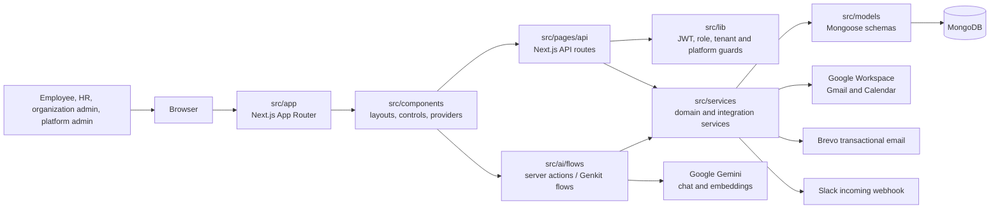
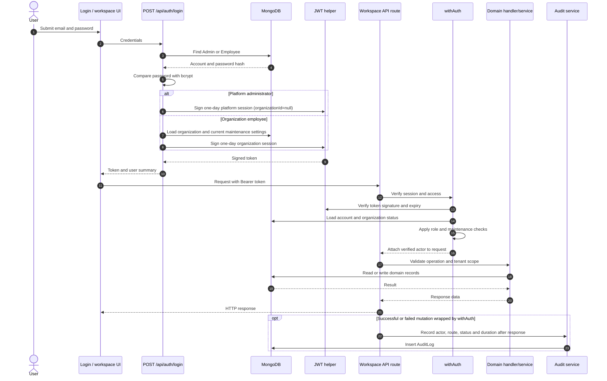
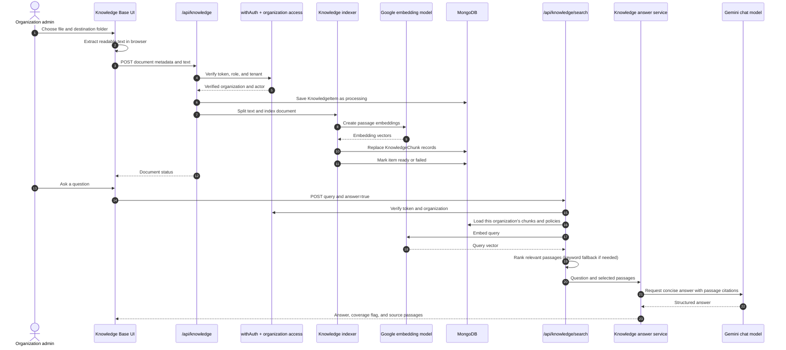
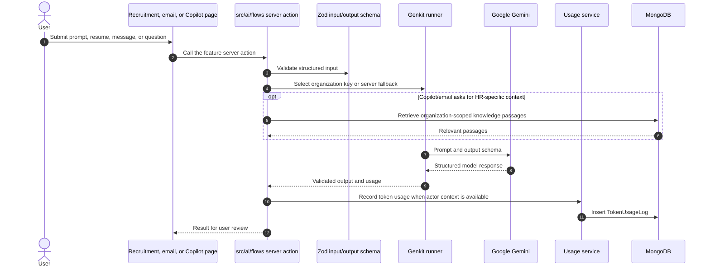
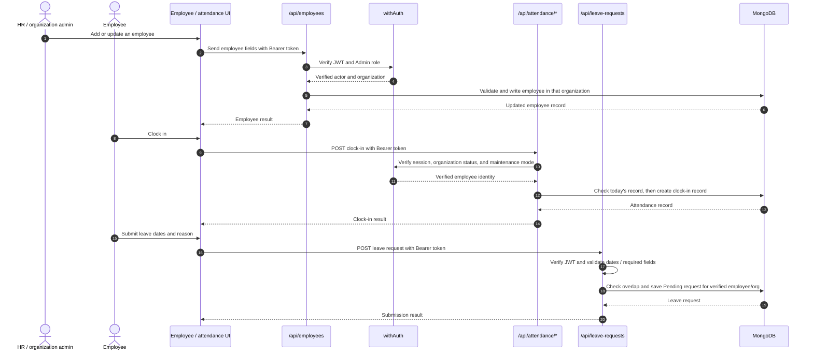
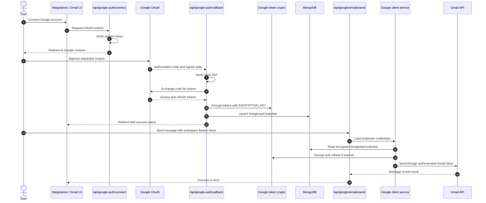
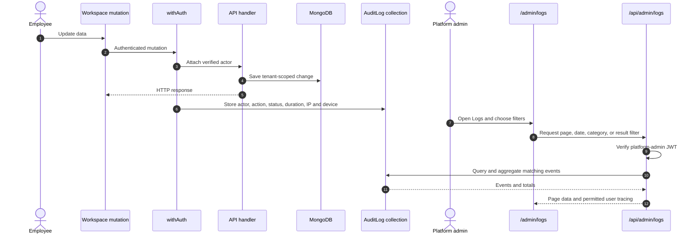
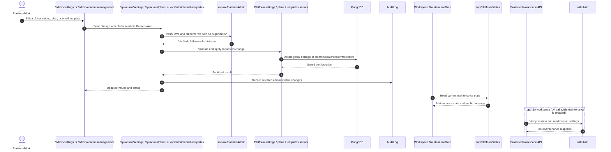
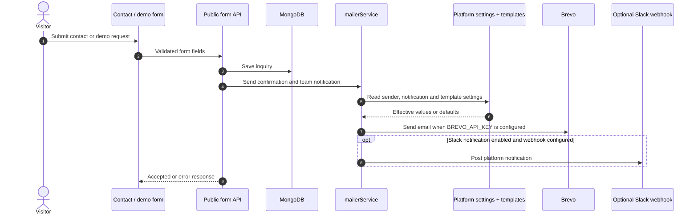

# HR Streamline AI

HR Streamline AI is a multi-tenant HR operations workspace. It combines employee and organization administration, attendance and leave workflows, recruitment assistance, Google Workspace integration, an organization-scoped knowledge base, internal communication, and a separate platform administration console.

This README describes the modules that exist in this repository, how requests move through them, and how to run the application locally.

## Contents

- [Architecture at a glance](#architecture-at-a-glance)
- [Technology](#technology)
- [Repository map](#repository-map)
- [Application sections](#application-sections)
- [API modules](#api-modules)
- [Authentication and authorization](#authentication-and-authorization)
- [AI and knowledge base](#ai-and-knowledge-base)
- [Google Workspace integration](#google-workspace-integration)
- [Platform administration and audit](#platform-administration-and-audit)
- [Data models](#data-models)
- [Request sequences](#request-sequences)
- [Local development](#local-development)
- [Environment variables](#environment-variables)
- [Deployment files](#deployment-files)

## Architecture at a glance

The UI uses the Next.js App Router. JSON endpoints use the Next.js Pages Router under `src/pages/api`; the two routers run in the same Next.js application.



Typical responsibilities are divided as follows:

1. A page or client component in `src/app` collects user input and renders the result.
2. The operation calls an API route or a server action. API routes live in `src/pages/api`; AI actions live in `src/ai/flows`.
3. The handler validates the request and applies the appropriate authentication and organization/platform access checks.
4. Domain services contain reusable work such as token refresh, document indexing, email rendering, metrics aggregation, and audit event creation.
5. Mongoose models persist application state in MongoDB. Integrations call Google, Gemini, Brevo, or Slack when a feature needs them.

## Technology

- **Application:** Next.js 15, React 18, TypeScript
- **UI:** Tailwind CSS, shadcn/ui-style Radix components, Lucide icons, Recharts
- **Validation and forms:** Zod, React Hook Form
- **Database:** MongoDB Atlas or another MongoDB server, accessed with Mongoose
- **Authentication:** signed JWTs and bcrypt password hashes
- **AI:** Genkit with the Google AI plugin
- **Google Workspace:** Google APIs for Gmail and Calendar
- **Outbound email:** Brevo
- **Optional team notifications:** Slack incoming webhooks
- **Charts and dates:** Recharts and date-fns

## Repository map

```text
HR_AgenticUI/
├── public/                 Static images, sounds, and other browser assets
├── scripts/                One-time operational scripts (for example, token encryption)
├── src/
│   ├── app/                App Router pages, layouts, and route-local components
│   ├── pages/api/           Pages Router JSON endpoints
│   ├── ai/                  Genkit setup, AI flows, schemas, and model selection
│   ├── components/          Shared layouts, application components, and UI primitives
│   ├── contexts/            Client-side providers, including authentication state
│   ├── hooks/               Shared React hooks
│   ├── lib/                 Database, JWT, encryption, access, and utility helpers
│   ├── models/              Mongoose schemas and model types
│   └── services/            Domain services and external integrations
├── Dockerfile
├── docker-compose.yml
├── k8s/                     Kubernetes deployment and secret templates
├── next.config.ts
├── package.json             Canonical scripts and dependencies for this app
└── README.md
```

The root `package.json` is the application package manifest. Run npm commands from the repository root. A duplicate `src/package.json` is present for historical reasons; it is not a separate deployable application.

### Source directory responsibilities

| Path | Responsibility |
| --- | --- |
| `src/app` | User-facing routes, public content, layouts, and route-specific UI |
| `src/pages/api` | JSON APIs, OAuth callbacks, and server-side request handlers |
| `src/ai` | Genkit configuration, model selection, schemas, and server actions |
| `src/components` | Shared app layouts, navigation, Copilot, tours, and reusable controls |
| `src/components/ui` | Reusable accessible UI primitives built on Radix and Tailwind |
| `src/contexts` | Authentication and other shared client state |
| `src/hooks` | Reusable React hooks, including mobile and toast helpers |
| `src/lib` | Cross-cutting utilities: JWT, encryption, MongoDB, auth, and helpers |
| `src/models` | MongoDB document schemas and domain types |
| `src/services` | Business logic shared by APIs and AI flows; external service clients |
| `public` | Images, sounds, and other static assets |
| `scripts` | Maintenance and migration utilities; not part of a request path |

## Application sections

### Public site and account access

- `/` — product landing page.
- `/contact`, `/book-a-demo` — lead forms backed by contact-submission and demo-request APIs.
- `/login`, `/register`, `/forgot-password`, `/reset-password`, `/login/magic` — account access and recovery.
- `/blog`, `/blog/[slug]` — editorial content from `src/lib/blog`.
- `/docs` — in-app product guides from `src/lib/docs`; article slugs are available as hash links.
- `/legal/privacy`, `/legal/security`, `/legal/terms` — public legal and security information.
- `/robots.txt`, `/sitemap.xml` — generated by `src/app/robots.ts` and `src/app/sitemap.ts`.

### Signed-in HR workspace

Most signed-in routes use the shared `AppLayout` in `src/components/layout/app-layout.tsx`. It provides the navigation sidebar, user menu, account-status overlay, Copilot sidebar, app tour, and maintenance gate.

| Route | Module |
| --- | --- |
| `/dashboard` | Organization workspace overview |
| `/manage-employees`, `/manage-employees/[id]` | Employee directory and employee records |
| `/employee-onboarding`, `/onboarding/[token]` | Onboarding flows |
| `/employee-hierarchy` | Organization reporting hierarchy |
| `/attendance-management` | Employee attendance actions |
| `/attendance-reporting` | Attendance reporting and related HR tools |
| `/tasks` | Kanban-style task board |
| `/recruitment` | Job description generation, resume analysis, and screening interview assistance |
| `/email-assistance`, `/smart-drafting` | AI-assisted email writing |
| `/gmail-inbox` | Gmail inbox, message details, replies, and AI reply drafts |
| `/unified-communications` | Communications workspace |
| `/community` | Organization-scoped posts, likes, and comments |
| `/knowledge-base` | Organization documents, folders, search, and grounded answers |
| `/support` | Support ticket submission and tracking |
| `/integrations` | Google integration status and connection controls |
| `/settings` | Organization policy, API key, and usage settings |
| `/profile` | User profile and account actions |
| `/audit-log` | User's own audit trail; platform/org-wide scope depends on role |
| `/payroll` | Payroll section in the workspace UI |

### Platform admin console

The platform console has its own layout at `/admin`; it is separate from the signed-in organization workspace. Admin API routes use the platform-admin guard so an organization-level `Admin` does not gain platform-wide access just from the role name.

| Route | Module |
| --- | --- |
| `/admin/login` | Platform-admin entry page |
| `/admin` | Platform overview dashboard |
| `/admin/organizations`, `/admin/organizations/[id]` | Organization directory and detail |
| `/admin/users` | Platform-admin user management |
| `/admin/analytics` | Usage, signup, and action metrics |
| `/admin/logs` | Searchable audit activity, event details, and user tracing |
| `/admin/system-health` | Database, configuration, and recent-failure checks |
| `/admin/community-posts` | Community moderation and post detail |
| `/admin/customer-inquiries` | Contact and demo inquiry review |
| `/admin/support-tickets` | Platform support queue |
| `/admin/content-management` | Subscription plan and email-template configuration |
| `/admin/settings` | Platform settings, maintenance mode, notifications, and integrations |

## API modules

API routes are implemented in `src/pages/api`. Methods and access checks are enforced by the individual handler; authenticated routes commonly use `withAuth`, and platform routes use `requirePlatformAdmin`.

| API path | Purpose |
| --- | --- |
| `/api/auth/*` | Login, registration, password recovery/change, and magic login |
| `/api/employees/*` | Employee CRUD, search, bulk import, and bulk deletion |
| `/api/attendance/*` | Clock in/out, attendance records, and role-scoped dashboard data |
| `/api/leave-requests` | Create and read leave requests |
| `/api/profile/*` | Profile updates and account deletion |
| `/api/settings/*` | Organization AI API key, policy, and usage endpoints |
| `/api/knowledge`, `/api/knowledge/[id]` | List/create folders and documents, rename, move, retry, and delete items |
| `/api/knowledge/search` | Search relevant passages or request a grounded answer |
| `/api/community/posts/*` | Posts, reactions, comments, and comment deletion |
| `/api/support/tickets` | Organization support-ticket operations |
| `/api/google-auth/*` | Google OAuth connect, callback, status, and disconnect |
| `/api/google/emails/*` | List, view, modify, and send Gmail messages |
| `/api/google/calendars/primary/events` | Read primary Google Calendar events |
| `/api/audit-logs` | Read audit events scoped to the verified user's organization or self |
| `/api/admin/*` | Platform admin APIs for organizations, users, moderation, metrics, logs, health, settings, plans, and templates |
| `/api/plans` | Publicly available active subscription-plan data |
| `/api/platform/status` | Current maintenance-gate state for the workspace |
| `/api/contact-submissions`, `/api/demo-requests` | Public website lead forms |

`/tasks` and `/payroll` currently have App Router pages but no dedicated API handlers under `src/pages/api`. Their presence in the navigation does not imply a separate server-side persistence module.

## Authentication and authorization

`src/lib/jwt.ts` signs and verifies session tokens. Passwords are checked with bcrypt. The client `AuthProvider` exposes the current session to the UI; this client state improves navigation but is not the server-side authorization boundary.

There are two server-side access patterns:

- **Organization/workspace APIs:** `withAuth` verifies the JWT, checks the account and organization status, applies role restrictions where requested, checks maintenance mode, and attaches the verified actor to `req.user`. The handler must still scope database operations to that actor's organization.
- **Platform-admin APIs:** `requirePlatformAdmin` verifies the JWT and requires a platform role with no organization association. This distinction is important because both platform and organization administrators can have an `Admin` role.
- **Self-authenticating handlers:** a few flows such as OAuth callbacks and public account recovery validate their own token or request state instead of using `withAuth`.

`src/lib/encryption.ts` uses AES-256-GCM for secrets stored by the application. Google OAuth tokens use a versioned encrypted format via `src/services/google-token-crypto.ts`; legacy plain-text tokens can be converted using `scripts/encrypt-google-tokens.ts`.

## AI and knowledge base

### AI flows

Genkit is initialized in `src/ai/genkit.ts`. The shared model identifier is in `src/ai/models.ts`. Each flow has a Zod input/output schema in `src/ai/schemas` and a server action in `src/ai/flows`.

| Flow | Feature |
| --- | --- |
| `generate-job-description` | Create a job description from role requirements |
| `analyze-resume-flow` | Summarize a resume, extract strengths and keywords, and produce an ATS-style assessment |
| `ai-interviewer` | Generate structured initial interview questions/assessment |
| `draft-email-response` | Draft or revise HR email responses |
| `copilot-chat-flow` | Conversational HR Copilot, optionally enriched by organization knowledge |
| `summarize-github-activity` | Summarize GitHub activity |

Flows can use the server-configured `GOOGLE_API_KEY` fallback or an organization-provided key. Usage is recorded by `src/services/usageService.ts` when the flow has the required employee and organization context.

### Knowledge base modules

- **UI:** `src/app/knowledge-base` and its upload, folder, document preview, and ask components.
- **Client API wrapper:** `src/lib/knowledge-client.ts`.
- **Endpoints:** `src/pages/api/knowledge`.
- **Access and validation:** `src/services/knowledge/access.ts`; organization scope comes from the verified token.
- **Indexing:** `chunking.ts`, `embeddings.ts`, and `indexer.ts` split document text, create embeddings, and save chunks.
- **Retrieval and answers:** `search.ts`, `prompt.ts`, and `answer.ts` find relevant passages and produce cited answers. Company policies are searchable alongside uploaded documents.
- **Persistence:** `KnowledgeItem` stores folder/document metadata and source text; `KnowledgeChunk` stores passages and embeddings.

The browser extracts readable text from supported documents before upload; the server stores the document and indexes its text. Search is tenant-scoped. Semantic retrieval uses embeddings and falls back to keyword scoring if the embedding service is unavailable.

## Google Workspace integration

`src/services/google.ts` creates Gmail and Calendar clients using per-employee credentials from `GoogleApiCredential`. The OAuth flow starts in `/api/google-auth/connect`, returns through `/api/google-auth/callback`, stores encrypted tokens, and refreshes access tokens when needed. Gmail and Calendar endpoints in `src/pages/api/google` use the authenticated employee identity.

The OAuth consent screen requests Gmail read/send/compose/modify scopes and read-only Calendar access. Register the matching callback URL with the Google OAuth client:

```text
http://localhost:9002/api/google-auth/callback
```

## Platform administration and audit

- `src/lib/platform-admin.ts` centralizes the platform-admin JWT check.
- `src/services/platform/settings.ts` reads and updates the singleton platform settings record; reads are cached in memory for 15 seconds.
- `src/services/platform/plans.ts`, `email-templates.ts`, and `slack.ts` handle platform configuration and notifications.
- `src/services/admin/platform-metrics.ts`, `system-health.ts`, and `log-query.ts` implement dashboard and observability queries.
- `src/services/audit` describes and writes audit events. Mutating requests wrapped with `withAuth` are recorded after their response finishes; selected login and platform-admin actions record events directly.
- `AuditLog` records actor, action, result, request metadata, and optional duration. MongoDB expires audit records after the configured retention period. The log viewer scopes organization admins to their organization and other users to their own events.
- `src/components/layout/maintenance-gate.tsx` reads `/api/platform/status`; the API guard also enforces maintenance mode on protected workspace requests. Platform administrators remain able to access the platform console.

The settings screen exposes whether server-side environment secrets are configured, not their values. Keep actual credentials in local environment files or a deployment secret manager.

## Data models

Mongoose schemas live in `src/models`. Main collections include:

| Model | Data |
| --- | --- |
| `Organization` | Tenant identity, settings, status, and organization-level policy |
| `Employee`, `Admin` | Workspace users and platform administrators |
| `AttendanceRecord`, `LeaveRequest` | Attendance and leave workflow records |
| `Post`, `Comment` | Organization community activity |
| `SupportTicket` | Support requests |
| `CompanyPolicy` | Organization policy documents |
| `KnowledgeItem`, `KnowledgeChunk` | Knowledge folders, source documents, passages, and embeddings |
| `GoogleApiCredential` | Per-user Google OAuth credentials |
| `TokenUsageLog` | AI feature token-usage data |
| `AuditLog` | Security and administrative activity |
| `PlatformSettings`, `SubscriptionPlan`, `EmailTemplate` | Global platform configuration |
| `ContactSubmission`, `DemoRequest` | Public-site inquiries |

`src/lib/mongodb.ts` caches the Mongoose connection during development hot reloads and serverless invocations. Services and handlers should use the shared connection helper rather than creating a new connection per operation.

## Request sequences

The diagrams below show the main end-to-end paths. Individual endpoints can have additional validation and error branches.

### Sign in and call a protected workspace API



Some handlers verify JWTs directly rather than using `withAuth`. For those, use the handler itself as the source of truth for its authorization behavior.

### Upload a knowledge document and ask a question



### Generate an AI result



### Manage employees, attendance, and leave



Employee CRUD endpoints use role checks for administrative operations. Attendance routes use `withAuth`. The leave-request route verifies its JWT directly and currently defaults reads to the authenticated employee's own requests.

### Connect Google and send a Gmail message



### Record and inspect audit activity



### Change platform-wide settings or content



### Send a public-form notification



## Local development

Use the repository root (the directory containing the root `package.json`):

```bash
npm install
```

Create `.env.local` in that same directory and fill in the required values below. Do not commit this file or paste production credentials into the README.

Start the web application:

```bash
npm run dev
```

The development server uses port **9002**: [http://localhost:9002](http://localhost:9002).

Optional project commands:

```bash
npm run genkit:dev    # Start the Genkit development UI/runtime
npm run genkit:watch  # Start Genkit with flow-file watching
npm run build         # Build the Next.js app
npm start             # Serve a production build
npm run lint          # Run the configured Next.js lint command
npm run typecheck     # Run tsc --noEmit
```

The AI flows are called as server actions from the application. The separate Genkit commands are for flow development and inspection.

### Environment variables

| Variable | Required | Purpose |
| --- | --- | --- |
| `MONGODB_URI` | Yes | MongoDB connection string |
| `JWT_SECRET` | Yes | Signs and verifies user session JWTs; use a long random secret |
| `ENCRYPTION_KEY` | Yes for encrypted secrets | Base64-encoded 32-byte key for AES-256-GCM encryption |
| `NEXT_PUBLIC_BASE_URL` | Yes for Google OAuth | Public app origin used to construct the OAuth callback; local value is `http://localhost:9002` |
| `GOOGLE_CLIENT_ID` | For Google integration | Google OAuth client ID |
| `GOOGLE_CLIENT_SECRET` | For Google integration | Google OAuth client secret |
| `GOOGLE_API_KEY` | Optional fallback | Server-side Gemini key used when no organization-specific key is supplied |
| `BREVO_API_KEY` | Optional | Enables transactional email delivery; without it outbound notifications are disabled |

Generate a suitable encryption key with:

```bash
openssl rand -base64 32
```

Keep `JWT_SECRET`, `ENCRYPTION_KEY`, API keys, OAuth credentials, and the database URI private. Changing the encryption key makes previously encrypted values unreadable. Google OAuth credentials also need the callback URL shown in [Google Workspace integration](#google-workspace-integration) allow-listed in the Google Cloud Console.

### Local database

Use a MongoDB instance you control and put its URI in `MONGODB_URI`. Collections are created by Mongoose as features write data. Keep development and production databases separate.

## Deployment files

- **Docker:** `Dockerfile` builds the Next.js application and serves it on port 3000. `docker-compose.yml` provides a container configuration and loads `.env.local`.
- **Kubernetes:** `k8s/deployment.yaml`, `k8s/service.yaml`, and `k8s/secret.yaml` are starter templates. Replace the image and secret placeholders before use; do not commit real secrets.
- **Next.js hosting:** the app can also be deployed to a Next.js-compatible host. Configure the same environment variables in the host's secret/environment settings.

The local npm development server runs on port 9002; the container and Kubernetes manifests use port 3000.
